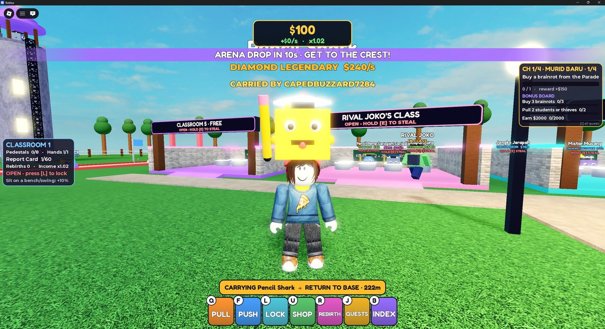

# Brainrot School: Enchanted Academy

[](https://make.fun/bounty/roblox-brainrot-01)
[](https://make.fun/bounty/roblox-brainrot-01/leaderboard)
[](https://make.fun/bounty/roblox-brainrot-01)

A Roblox brainrot game for [make.fun's roblox-brainrot-01 bounty](https://make.fun/bounty/roblox-brainrot-01): a magic forest school where students collect absurd school-themed brainrots, carry them home to their classroom, and climb a ladder of rarities, mutations and rebirths — while rivals pull, push and steal, a lunch rush stampedes the field, and a naughty crow raids unlocked classrooms.

**Play it:** https://www.roblox.com/games/79538854183879
**Bounty:** https://make.fun/bounty/roblox-brainrot-01
**Referral:** https://make.fun/r/87aq1dky



## The loop

Brainrots walk the Parade Lane past the academy — **click one to buy it**, carry it home to your classroom, and it earns money every second from its pedestal. Spend the cash on the next tier up, lock your classroom before a rival steals your best earner, and rebirth your way to Secret tier.

- **Parade Lane:** a new brainrot walks in every 4 seconds and takes 45 seconds to cross. Click to buy — no key prompt.
- **Carry:** one brainrot at a time (two with the Big Bag upgrade). A dropped brainrot lies on the field for 60 seconds before it wanders off.
- **Classroom:** 8 pedestals per base at the start; the Extra Slot upgrade adds 4 each level. Start with $100.
- **High pads:** Mythic-or-better brainrots appear on the high places (gym climbing wall top, big tree top, academy tower) every 45 seconds — free to grab.

## The cast — 80 brainrots, 16 tiers

Every brainrot is an original school-or-forest character (Pensil Penguin, Buku Bebek, Tas Tupai, Kapur Kura, …), built from code — no downloaded models. Income roughly doubles every tier; the buy price is always 12× the income.

| Tier | Rarity | Income range |
|---|---|---|
| 1 | Common | $5–$8/s |
| 2 | Uncommon | $10–$16/s |
| 3 | Rare | $20–$32/s |
| 4 | Epic | $40–$64/s |
| 5 | Legendary | $80–$128/s |
| 6 | Mythic | $160–$256/s |
| 7 | Divine | $320–$512/s |
| 8 | Hidden | $640–$1,024/s |
| 9 | Celestial | $1,280–$2,048/s |
| 10 | Galactic | $2,560–$4,096/s |
| 11 | Eternal | $5,120–$8,192/s |
| 12 | Godly | $10,240–$16,384/s |
| 13 | Supreme | $20,480–$32,768/s |
| 14 | Ultimate | $40,960–$65,536/s |
| 15 | PRINCIPAL | $81,920–$131,072/s |
| 16 | Secret | $163,840–$786,432/s |

Top earner: **Misteri Manta**, $786,432/s.

### Mutations

A brainrot can spawn mutated — it then earns its income times the multiplier. Rolls are checked rarest first, so one roll wins at most one mutation.

| Mutation | Multiplier | Chance |
|---|---|---|
| GOLD | ×2 | 8% |
| DIAMOND | ×3 | 4% |
| LAVA | ×4 | 2% |
| RAINBOW | ×6 | 1% |
| GLITCH | ×10 | 0.5% |

## Player vs player — pull, push, steal

No top-10 brainrot game has physical player interaction. This one does:

- **PULL [Q]:** reach 30 studs, slow a carrier to speed 8 for 3 seconds (8s cooldown).
- **PUSH [F]:** close range (12 studs), 60% chance the brainrot they carry DROPS — anyone can grab it (6s cooldown).
- **STEAL [E]:** near a brainrot on a rival's UNLOCKED classroom, a floating prompt offers the steal. Take it and the owner is alerted. A locked base shows LOCKED and cannot be stolen from.
- **LOCK [L]:** shields your classroom for 60 seconds, then a 30-second recharge (120 seconds with the Long Lock upgrade).
- Your own classroom is a safe zone.

## Quests — the main structure

Three chapters in order, each step paying cash:

| Chapter | Steps |
|---|---|
| **Murid Baru** | Buy your first brainrot (+$150) · Place one in your classroom (+$200) · Lock your base once (+$250) |
| **Naik Kelas** | Steal a brainrot (+$800) · Pull or push a carrier (+$600) · Place 5 brainrots (+$1,000) |
| **Bintang Sekolah** | Rebirth once (+$3,000) · Own 30 different brainrots (+$5,000) · Steal 3 brainrots (+$4,000) |

Plus **3 daily quests a day**, drawn deterministically from a pool of 6 (buy 3, steal 1, earn $5,000, place 3, pull/push 3, buy Rare-or-better). The QUEST panel in the HUD tracks them live.

## Gacha + Fuse

- **Gacha Machine** (near the cafeteria): flat **$1,000 per roll**, weighted toward the rare end, small mutation chance. The result goes straight to your classroom; blocked with "Base penuh!" when full.
- **Fuse Lab** (near the gym): pick **3 brainrots of the same tier** and fuse them into **1 random brainrot of the next tier** — free, the three are the cost. Three PRINCIPAL brainrots fuse into a random Secret; three Secret fuse into a random Secret with a random mutation.

## Hazards

- **LUNCH RUSH!** — every 90 seconds a 15-second countdown warns of the stampede, then it sweeps the field for 6 seconds. Shelter in your classroom.
- **Gagak Nakal** — the naughty crow visits an unlocked classroom every 120 seconds and flies off with a brainrot. Lock up.
- **Sit down:** benches and swings in the arena take [E] to sit — the **Fresh buff** pays +10% income for 60 seconds (3-minute cooldown).

## Progression

- **Rebirth:** costs $25,000 × 2^rebirths, adds **+1× income** each time.
- **Report Card:** the 80-entry collection index — every unique brainrot owned adds **+2% income** (up to +160% at 80/80).
- **Upgrades (5):** Speed Shoes (+4 walk speed/level) · Big Bag (carry 2) · Long Lock (120s lock) · Extra Slot (+4 pedestals) · Lucky Charm (rarer parade spawns).

## Controls

| Key | Action |
|---|---|
| Click | Buy a brainrot from the Parade |
| Q | Pull a carrier |
| F | Push a carrier |
| E | Steal (rival classroom) / Sit (bench or swing) / Gacha / Fuse |
| L | Lock your classroom |

## Screenshots

Four real captures of the published game running:

1. `1-cover.jpg` — carrying a DIAMOND LEGENDARY Pencil Shark home, with a rival classroom and the ARENA DROP banner (also the game's first thumbnail on Roblox).
2. `2-academy.jpg` — the academy front, HUD and quest panel.
3. `3-report-card.jpg` — the Report Card grid, tiers up to PRINCIPAL $131K/s.
4. `4-quests.jpg` — the QUESTS panel: 3 chapters plus the daily board.

## Build & run

The game is a Rojo project (Node 22, Rojo 7.7.1). The world is built from code — `WorldBuilder` lays down the academy, classrooms, parade lane, arena and high pads at runtime.

```sh
rojo build default.project.json --output game.rbxl
```

Open `game.rbxl` in Roblox Studio to playtest, or publish it as the experience. The entry dossier is built with:

```sh
MAKEFUN_OUTPUT_DIR=out node main.ts
```

`main.ts` (Node 22, stdlib only) copies `game.rbxl`, `src/`, `screenshots/` and `PLAY.json` to the output directory and writes `dossier.json` with the vendored make.fun library. Two runs produce byte-identical output.

## Repo layout

24 Luau files, 4,364 lines. The server owns all state (money, ownership, quests, locks); the client only renders and asks through `RemoteHub`.

- `src/server/` — 19 server scripts: `init.server`, `WorldBuilder`, `Spawner`, `CarrySystem`, `StealSystem`, `PullPushSystem`, `SitSystem`, `GachaSystem`, `FuseSystem`, `QuestSystem`, `HazardSystem`, `CrowThiefSystem`, `RebirthSystem`, `UpgradeSystem`, `LockSystem`, `IncomeTicker`, `PlayerState`, `BrainrotFactory`, `RemoteHub`.
- `src/client/` — `Game.client` (HUD, Report Card grid, gacha/fuse panels, Q/F/L actions).
- `src/shared/` — `BrainrotCatalog` (80 entries), `Config` (all tuning numbers), `QuestCatalog`, `UpgradeCatalog`.
- `screenshots/` — 4 captures (each ≤256 KiB, 1280×696).
- `PLAY.json` — the published place (place 79538854183879, universe 10777954728).
- `vendor/makefun-roblox.ts` — the kit's dossier library, unchanged.
- `TOUR.json` — key presses + functions to reach each screenshot in Studio.
